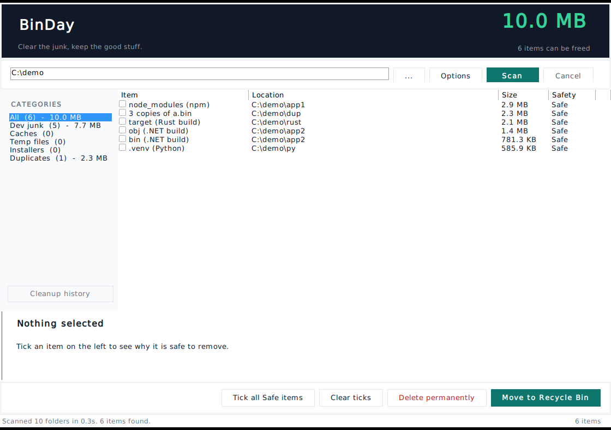

<div align="center">


# BinDay

**Free up space on your Windows PC.**

[](https://github.com/khansarim007/binday/actions/workflows/ci.yml)
[](LICENSE)
[](https://learn.microsoft.com/en-us/windows/whats-new/)
[](https://github.com/khansarim007/binday/releases/latest)

[Download](https://github.com/khansarim007/binday/releases/latest/download/BinDay-windows.zip) &middot;
[Website](https://khansarim007.github.io/binday/) &middot;
[Releases](https://github.com/khansarim007/binday/releases)

</div>

---

BinDay is a small native Windows app that finds the things your machine does not
need any more - build output, dependency folders, package caches, temp files,
old installers and duplicate files - shows you exactly what it found and **why it
is safe to remove**, and then waits for you to say yes.

**Nothing is deleted on its own. Ever.**



## Why another cleaner

Most disk cleaners work by hiding the decision from you: a green button, a
progress bar, and a folder you did not know existed is gone. BinDay is the
opposite. Every item comes with a size, a plain sentence explaining what
removing it means, and a grade that decides what the app is allowed to do.

| Grade     | Meaning                                                      | Permanent delete |
|-----------|--------------------------------------------------------------|------------------|
| `Safe`    | Regenerated automatically by your tools                       | allowed          |
| `Check`   | Regenerated, but the next build would need the network        | refused          |
| `Review`  | Could be something you want to keep (old installers)           | refused          |

Only `Safe` items can ever be deleted permanently, and that rule lives in the
engine rather than in the button.

## What it finds

**Build output and dependencies** - each one needs a marker file next to it
before BinDay will touch it, so a folder that is merely *called* `bin` is left
alone.

| Folder | Needs | Grade |
|---|---|---|
| `node_modules` | `package.json` | Safe |
| `.next`, `.nuxt`, `.svelte-kit`, `.angular`, `.turbo`, `.parcel-cache` | `package.json` | Safe |
| `coverage` | `package.json` | Safe |
| `obj`, `bin` | `*.csproj`, `*.fsproj`, `*.vbproj`, `*.sln` | Safe |
| `.vs` | `*.sln`, `*.csproj` | Check |
| `target` | `Cargo.toml` | Safe |
| `.venv`, `venv` | `pyproject.toml`, `requirements.txt`, `setup.py`, `Pipfile` | Safe |
| `__pycache__` | - | Safe |
| `.pytest_cache`, `.mypy_cache`, `.ruff_cache` | - | Safe |
| `.dart_tool` | `pubspec.yaml` | Safe |
| `.gradle` (project local) | `settings.gradle`, `build.gradle` | Safe |
| `.zig-cache`, `zig-out` | `build.zig` | Safe |

**Known caches** - checked wherever they live, not only inside your scan folder.

| Location | Grade |
|---|---|
| `%LOCALAPPDATA%\npm-cache`, `\Yarn\Cache`, `\pnpm\store`, `\pip\Cache` | Safe |
| `%LOCALAPPDATA%\Temp` | Safe |
| `%USERPROFILE%\.nuget\packages` | Check |
| `%USERPROFILE%\.gradle\caches` | Check |
| `%USERPROFILE%\.m2\repository` | Check |

**Old installers** - `.msi`, `.iso`, `.dmg`, `.pkg`, `.exe` over 50 MB and more
than 30 days old, in Downloads and on the Desktop. Always `Review`, so they can
only ever go to the Recycle Bin.

**Duplicate files** - grouped by size, then by a cheap prefix hash, then by a
full SHA-256. Only files that agree on all three are duplicates. The copy with
the shortest path is kept; the rest are offered for removal.

## Safety rails

- Nothing is deleted until you tick it and confirm.
- Permanent delete is refused for anything not graded `Safe`.
- `Windows`, `Program Files`, `ProgramData`, `AppData`, `System Volume
  Information`, `$Recycle.Bin` and drive roots are never walked and never
  deleted.
- Symbolic links and junctions are never followed.
- `.git`, `.svn`, `.hg` and `site-packages` are skipped.
- Every cleanup is written to `%LOCALAPPDATA%\BinDay\history.jsonl` and can be
  read back inside the app.
- No admin rights, no account, no network access, no telemetry.

## Install

Download **[BinDay-windows.zip](https://github.com/khansarim007/binday/releases/latest/download/BinDay-windows.zip)**,
unzip it anywhere, and double click `Install.bat`.

That copies the app to `%LOCALAPPDATA%\Programs\BinDay` and adds a Desktop icon
and a Start menu entry. `Uninstall.bat` removes both again. Nothing outside
your user profile is touched.

You can also just run `BinDay.exe` from the unzipped folder - the installer is
only a convenience.

## Use

1. Pick the folder to scan (your user profile is pre-filled; several folders
   can be listed, separated by `;`).
2. Press **Scan**.
3. Click an item to read why it is safe, or press **Tick all Safe items**.
4. Press **Move to Recycle Bin** (recoverable) or **Delete permanently**.

`Options` switches the categories on and off and sets the duplicate size floor
(1 MB, 10 MB, 100 MB or 1 GB) and the installer age limit. **Cleanup history**
at the bottom of the sidebar shows what was removed in the past and how much
space that freed.

From the command line:

```
BinDay.exe "C:\dev\my-project"
```

scans that folder as soon as the window opens.

## Build it yourself

Needs the .NET SDK (to build and run the tests) and nothing else. The app
itself only needs the .NET Framework 4.8 that already ships with Windows 10
1903+ and Windows 11.

```bash
git clone https://github.com/khansarim007/binday.git
cd binday
./build.sh
```

That runs the test harness, builds the exe and refreshes `dist/` and
`BinDay-windows.zip`.

## Layout

```
src/Core/Model.cs      data model, safety grades, path guard
src/Core/Rules.cs      the rule table (what is disposable and why)
src/Core/Scanner.cs    the scanner and the duplicate finder
src/Core/Cleaner.cs    recycle bin and permanent delete
src/Core/History.cs    the cleanup history file and its reader
src/Ui/Theme.cs        colours, fonts, small control helpers
src/Ui/MainForm.cs     the main window
src/Ui/OptionsForm.cs  the options dialog
src/Ui/HistoryForm.cs  the cleanup history window
tests/Tests.cs         75 checks over the whole engine
installer/             Install.bat / Install.ps1 / Uninstall.*
dist/                  the shippable folder
docs/                  screenshots of the real window
site/                  the website (plain HTML, no build step)
legacy/                the earlier duplicate finder, kept for reference
```

The engine has no dependency on WinForms, which is why the test harness can run
it on any machine (Linux included) and why the rules can be unit tested
directly.

## Tests

```bash
dotnet run --project tests -c Release
```

75 checks covering rule matching, marker files, exclusions, duplicate
detection, keeper choice, size measurement, the path guard, recycling,
permanent delete refusals, history output and cancellation.

## Website

The landing page lives in [`site/`](site/README.md) and is plain HTML, CSS and
one small script - no framework, no build step.

**Vercel** (the recommended host):

1. Vercel → **Add New → Project** → import `khansarim007/binday`
2. Framework Preset: `Other`
3. Leave the Root Directory on the repository root - the root `vercel.json`
   points Vercel at `site/` and skips the build, because there is nothing to
   build
4. **Deploy**

You can also set the Root Directory to `site`; `site/vercel.json` covers that
case. The download button points at the latest GitHub release, so cutting a
new release updates the site with no change to the page.

**GitHub Pages** works too: `.github/workflows/pages.yml` publishes `site/` to
`https://khansarim007.github.io/binday/` on every push to `main`.

## License

MIT. See [LICENSE](LICENSE).

The older duplicate finder that came before BinDay is kept in
[`legacy/`](legacy/README.md) under the same license.
